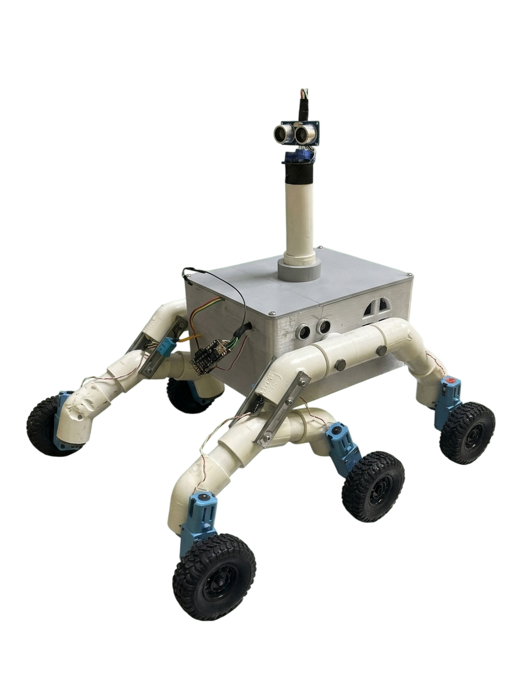
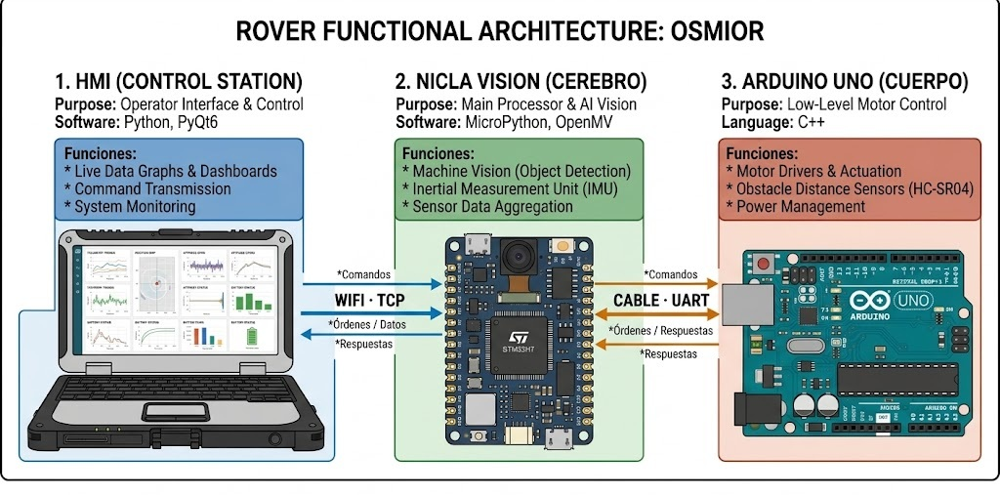
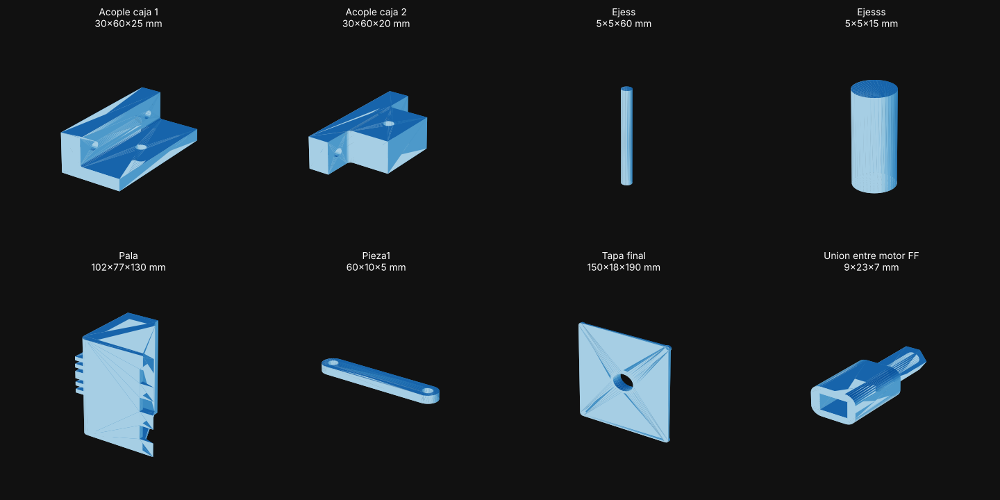

# OSMIOR-Rover

**Open Smart Modular Intelligent Operations Rover**: un rover terrestre experimental de seis ruedas con suspensión rocker-bogie, pensado para búsqueda y rescate tras desastres naturales. Se controla por teleoperación desde una HMI, tiene visión a bordo y telemetría en tiempo real.



> **Estado: proyecto cerrado (noviembre 2026).** Este repositorio conserva el historial completo de OSMIOR: firmware, HMI, documentación y fotos. Lo que se aprendió aquí sirve de base para **Resilience**, su sucesor más robusto.

---

## Arquitectura



```
HMI (PC, Python/PyQt6) ──WiFi / TCP :8080──► Nicla Vision (MicroPython/OpenMV) ──UART──► Arduino UNO (C++)
     gráficas, mando,                          visión, IMU, gateway,                    motores, sensores,
     telemetría, misión                         física, watchdog                         radar, audio
```

| Bloque | Hardware | Función |
|---|---|---|
| Estación de control | PC | HMI con PyQt6 y PyQtGraph: mando, gráficas, estado de misión, gauges de pitch/roll |
| "Cerebro" | Arduino Nicla Vision (STM32H747) | Punto de acceso WiFi, servidor TCP, detección de personas (TFLite 96×96 en escala de grises), IMU |
| "Cuerpo" | Arduino UNO | 6 motores TT 1:90 con 2× TB6612FNG, HC-SR04 izquierdo/derecho, radar (servo + HC-SR04), DHT11, BMP280 y DFPlayer Mini |
| Potencia | 2 packs 2S 18650 de 2200 mAh | Buck a 5 V para la lógica y buck a 6 V para los motores ([diagrama](media/Images/diagrama_alimentacion.jpg)) |

Datos del artículo: unos 3.2 kg de masa y unos 40 × 30 × 30 cm. Más detalle en [`docs/paper/Rover_OSMIOR_IEEE.pdf`](docs/paper/Rover_OSMIOR_IEEE.pdf) y en el [esquemático](media/Images/esquematico_electronico.jpeg).

## Mecánica y CAD

El chasis y la suspensión rocker-bogie están hechos con tramos de tubo PVC cortados según los planos de [`cad/planos_pvc`](cad/planos_pvc). Las piezas de unión, los acoples de los motores, los ejes, la tapa y la pala se imprimieron en 3D.



| Pieza (STL) | Medidas aprox. | Uso |
|---|---|---|
| `Acople caja 1` / `Acople caja 2` | 30 × 60 mm | Acoples de la caja |
| `Union entre motor FF` | 9 × 23 × 7 mm | Acople para el eje en doble D del motor TT |
| `Ejess` / `Ejesss` | Ø5 × 60 mm / Ø5 × 15 mm | Ejes |
| `Pieza1` | 60 × 10 × 5 mm | Eslabón con dos agujeros |
| `Pala` | 102 × 77 × 130 mm | Pala del módulo de recolección (v4; se retiró en v5) |
| `Tapa final` | 150 × 190 mm | Tapa de la caja |

Los archivos fuente están en [`cad/Inventor`](cad/Inventor). Si cambias el nombre de un `.ipt`, se rompe la referencia en `Ensamblaje1.iam`.

## Estructura del repositorio

```
firmware/
  uno/OSMIOR_UNO/OSMIOR_UNO.ino     Firmware del Arduino UNO
  nicla/OSMIOR_NICLA.py             Script de la Nicla Vision (OpenMV 5.x)
  tools/OSMIOR_MOTOR_TEST/          Prueba aislada de motores (desde v5.1)
hmi/OSMIOR_HMI.py                   Estación de control
docs/
  versiones/                        Notas técnicas de cada versión (auditorías, pruebas, pinouts)
  paper/                            Artículo IEEE
  competencia/                      Documento técnico UTB, pitch y póster
  expofisica/                       Anteproyecto y presentación mecánica
  latex/                            Fuentes LaTeX (guion de física, arquitectura de potencia)
  design_logs/                      DL-001 (mecánica) y DL-002 (potencia)
cad/
  SolidWorks/                       Primeras piezas (rocker en PVC, brazo)
  planos_pvc/                       Planos de los cortes de tubo PVC del rocker-bogie
  Inventor/                         Fuentes .ipt de las piezas impresas y ensamblaje .iam
  STL/                              Piezas listas para imprimir en 3D
media/Images/                       Fotos, diagramas y capturas
```

Los nombres de archivo son estables. Cada versión vive en el historial de git y tiene su **tag**. Para ver una versión concreta:

```bash
git checkout v3.0          # o navega el tag en GitHub
git diff v4.0 v5.0         # qué cambió entre dos versiones
```

## Historial de versiones

| Tag | Fecha | Cambios principales | Notas |
|---|---|---|---|
| `v1.0` | 08-oct-2026 | Firmware base del UNO: tracción, UART a la Nicla y dos HC-SR04 | — |
| `v2.0` | 08-oct-2026 | Fix de los motores sin respuesta (conflicto entre dos SoftwareSerial), protocolo con ACK, primera Nicla y HMI | [Auditoría V2](docs/versiones/V2_AUDITORIA.md) |
| `v3.0` | 09-oct-2026 | Comunicaciones robustas: comandos de 1 byte, telemetría a demanda, contadores de error, ACK RTT | [Auditoría](docs/versiones/V3_AUDITORIA.md) · [Pruebas](docs/versiones/V3_PRUEBAS.md) |
| `v4.0` | 19-oct-2026 | Radar, DHT11, BMP280, motor de recolección y pinout que usa los 16 pines | [README V4](docs/versiones/V4_README.md) |
| `v5.0` | 22-oct-2026 | Flujo de misión, estimación de desplazamiento por IMU, se quita la recolección, pinout según el cableado real | [README V5](docs/versiones/V5_README.md) |
| `v5.1` | 23-oct-2026 | Corrección de las pistas de audio (`playMp3Folder`) y sketch de diagnóstico de motores | [Fixes V5.1](docs/versiones/V5_1_FIXES.md) |

## Cómo ejecutarlo (v5.1)

1. **UNO:** abre `firmware/uno/OSMIOR_UNO/` en Arduino IDE e instala NewPing, DFRobotDFPlayerMini y Adafruit BMP280 (con Adafruit Unified Sensor). Pinout completo en [V5_README](docs/versiones/V5_README.md).
2. **microSD del DFPlayer:** `/MP3/0001.mp3` … `/MP3/0006.mp3` (cuatro dígitos, carpeta `MP3`).
3. **Nicla Vision:** OpenMV 5.x con el modelo `person_detect` cargado desde el Model Zoo. Ejecuta `firmware/nicla/OSMIOR_NICLA.py`. La Nicla crea su propia red WiFi (`Rover_OSMIOR_AP`).
4. **HMI:** `pip install PyQt6 pyqtgraph` y luego `python hmi/OSMIOR_HMI.py` estando conectado a esa red.
5. Antes de bajarlo al suelo, prueba siempre con las ruedas elevadas. Si los motores se portan raro, usa primero `firmware/tools/OSMIOR_MOTOR_TEST`.

## Qué se validó y qué no

Este proyecto se presenta con honestidad técnica:

- La detección de personas es un clasificador `person / no_person` de 96×96 en escala de grises, con los límites de RAM de la Nicla. **No se probó con supervivientes reales** ni en escombros.
- El desplazamiento que muestra la HMI es una **estimación por IMU**, no odometría: no hay encoders.
- Algunos valores de la HMI salen del **modelo físico** (por ejemplo, el torque) y no de una medición directa. Cada nota de versión dice qué se probó en hardware y qué solo pasó revisión de sintaxis o simulación.

## Problemas conocidos (lecciones para Resilience)

- La Nicla se reinicia cuando arrancan los motores, por ruido y caídas de tensión en la alimentación.
- Hay tramas UART corruptas: SoftwareSerial a 9600 compartido con el DFPlayer.
- El DFPlayer es poco confiable: sin cable de retorno no se detecta si falla la SD.
- Los motores TT tienen poca potencia para el peso del rover; un canal del TB6612 carga varios motores.
- El chasis es mejorable.
- La señal WiFi se propaga mal entre escombros.
- La comunicación HMI ↔ Nicla **no tiene cifrado** y la clave del AP está en el código.

## Equipo

Universidad del Norte, Barranquilla.

- **Artículo IEEE:** Samuel Sánchez, Carlos Meneses, José Torres y Andrés Lizcano.
- **Anteproyecto ExpoFísica:** Haniel Castro, Matías Candanoza, Samuel Sánchez y José Torres.

## Licencia

[MIT](LICENSE)
